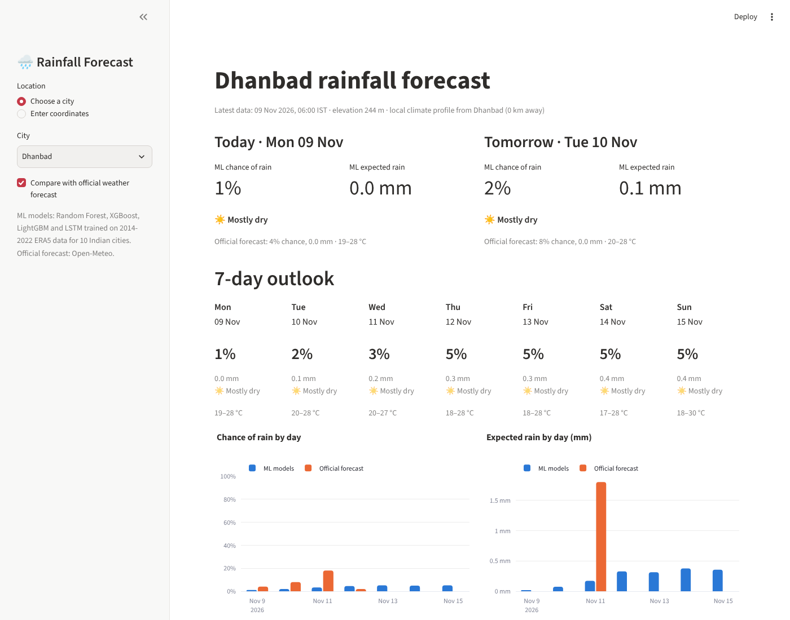

# Rainfall Prediction for India using Machine Learning

A BTech project that forecasts rainfall for Indian cities with machine learning:

* **7-day outlook**: for today and each of the next 6 days, the chance of rain (≥ 1 mm) and the expected amount in mm.
* **Today and tomorrow in detail**: hour-by-hour chance of rain and amount for the next 48 hours.
* **Benchmark**: every ML prediction is shown next to the official numerical weather forecast, so you can see how close machine learning gets to physics-based forecasting.

## Models

| Task | Models compared |
|---|---|
| Rain yes/no, days 1–7 | Climatology baseline, persistence baseline, Logistic Regression, Random Forest, XGBoost, LightGBM, LSTM, ensemble |
| Rain amount (mm), days 1–7 | Climatology baseline, Random Forest, XGBoost (Tweedie), LightGBM (Tweedie), LSTM |
| Hourly rain, next 48 h | Hourly climatology baseline, LightGBM (lead time as a feature), sequence-to-sequence LSTM |

The app shows the average of the tree models and the LSTM (the "ML models" line).

## Data

* **Source:** ERA5 reanalysis through the free [Open-Meteo](https://open-meteo.com) archive API, with 14 hourly variables: temperature, humidity, dew point, precipitation, sea-level and surface pressure, total and low cloud, wind speed, direction and gusts, solar radiation, soil moisture and vapour-pressure deficit.
* **Cities (10):** Mumbai, Kochi, Chennai, Bengaluru, Nagpur, Delhi, Jaipur, Kolkata, Dhanbad and Guwahati. Between them they cover the south-west monsoon coast, the north-east monsoon coast, the Deccan, central India, the semi-arid north-west, the Gangetic plain and the very wet north-east.
* **Period:** Jan 2014 to Oct 2026. **Time-based split:** train 2014–2022, validation 2023, test Jan 2024 to Oct 2026. The test years are never used for training or tuning.
* **Rainy day** = at least 1 mm in the day (IST). **Rainy hour** = at least 0.2 mm.

### Features (daily models, ~55)
Same-day weather (rain total, rainy hours, max hourly rain, temperature range, humidity, dew-point depression, pressure level and evening trend, cloud, wind as u/v components, radiation, soil moisture, VPD), rain over the previous 1–30 days and rainy-day counts, 1- and 3-day changes in pressure, humidity and temperature, season (day of year as sin/cos, month), location (lat, lon, elevation), and the city's climatological rain probability for the target day (from training years only).

### Features (hourly model, ~40)
Current conditions plus rain over the last 3, 6, 12, 24, 72 and 168 hours, 3/12/24-hour pressure tendency, humidity, temperature and cloud trends, hour of day for both origin and target, lead time, season, location, and hourly climatology by city, month and hour.

## Project layout

```
download_weather_data.py   standalone downloader (run on your own internet connection)
run_pipeline.sh            runs everything: data -> features -> models -> report
app.py                     Streamlit dashboard
src/
  config.py                cities, variables, paths
  download_data.py         same downloader, inside the pipeline
  import_raw_zip.py        loads the zip made by download_weather_data.py
  features.py              daily aggregation, lag/rolling/season features, 7-day targets
  hourly_features.py       hourly features and (origin, lead) samples
  build_dataset.py         builds data/processed/daily_features.parquet
  train_daily.py           7-day models + baselines + metrics
  train_hourly.py          48-hour LightGBM model
  train_lstm.py            daily and hourly LSTMs (PyTorch)
  evaluate.py              report figures and results_summary.md
  predict.py               live predictions for any Indian location
  cities.py                45 Indian cities for the app
models/                    trained models (created by the pipeline)
reports/                   metrics CSVs, figures, results_summary.md
```

## How to run

```bash
python -m venv .venv && source .venv/bin/activate      # Windows: .venv\Scripts\activate
pip install -r requirements.txt

# 1. Get the data (about 20 minutes; resumes if interrupted)
python download_weather_data.py                        # makes rainfall_raw_data.zip

# 2. Train everything and make the report (about 30-60 minutes on a laptop CPU)
bash run_pipeline.sh rainfall_raw_data.zip

# 3. Open the dashboard
streamlit run app.py
```

## How the live forecast works
1. The app downloads the last 40 days of hourly weather plus the official 7-day forecast for the chosen place (Open-Meteo forecast API, no key needed).
2. The past hours are turned into exactly the same features used in training.
3. Daily models predict days 1–7 (day 1 = today, from data up to the end of yesterday), and the hourly models predict the next 48 hours from the latest hour.
4. Places other than the 10 training cities use the climate profile of the nearest training city.

## Evaluation metrics
* **ROC-AUC**: how well the model ranks rainy days above dry days (0.5 = guessing, 1 = perfect).
* **Brier score / Brier skill score**: accuracy of the probabilities, and improvement over climatology (above 0 = better than climatology).
* **POD, FAR, CSI, F1**: standard meteorological verification scores at the chosen yes/no threshold (threshold tuned on 2023 validation data).
* **MAE / RMSE (mm)** for rainfall amounts.

## Results

All numbers are from the **untouched test period (Jan 2024 to Oct 2026)**, pooled over the 10 cities. Full tables are in `reports/results_summary.md` and charts in `reports/figures/`.



**Will it rain? (≥ 1 mm in a day)**

| Model | AUC, day 1 (today) | AUC, day 2 | AUC, day 3 | AUC, day 7 | Brier skill, day 1 |
|---|---|---|---|---|---|
| Climatology baseline | 0.888 | 0.888 | 0.887 | 0.886 | 0 |
| Logistic Regression | 0.930 | 0.905 | 0.897 | 0.886 | 0.20 |
| Random Forest | 0.933 | 0.909 | 0.901 | 0.890 | 0.22 |
| XGBoost | 0.933 | 0.908 | 0.898 | 0.888 | 0.23 |
| LightGBM | 0.934 | 0.908 | 0.898 | 0.887 | 0.23 |
| LSTM | 0.919 | 0.905 | 0.898 | 0.882 | 0.15 |
| **Final ensemble (RF + XGB + LGBM + LSTM)** | **0.933** | **0.910** | **0.901** | **0.890** | **0.23** |

On day 1 the tree ensemble gets **85.6% accuracy** (F1 0.83, CSI 0.71), against 80.8% for climatology and 83.1% for "same as yesterday". It catches 85% of rainy days (probability of detection) with an 18% false-alarm ratio.

**How much rain?** Day-1 mean absolute error is 3.3 mm (LightGBM), against 4.3 mm for climatology.

**Hourly model, next 48 hours (rain ≥ 0.2 mm in an hour):** LightGBM AUC is 0.91 for the next 1–6 hours, falling to 0.86 at 25–48 hours (hourly climatology: 0.84). The LSTM is close behind (0.90 → 0.85) and has the lowest error in mm.

**What this means**
* Machine learning clearly beats the baselines for **today and tomorrow**: day 1 is 23% better than climatology on the Brier score.
* Skill falls quickly with lead time. By days 5–7 the models are only 2–3% better than climatology, because past local weather can't see weather systems that haven't arrived yet. This is the expected limit of purely statistical forecasting and the main reason official forecasts use physics-based models.
* The most important features are the day's rain total, the number of rainy hours, the climatological rain chance for the target day, and evening cloud and rain (`reports/figures/feature_importance_day1.png`).
* The AUC values are pooled across very different climates (Jaipur to Kochi), which makes even climatology score high. The Brier skill score is the fairer measure of what the models add.

## Limitations
* The models are trained on ERA5 reanalysis (about 25–30 km grid), not on rain-gauge observations, so very local thunderstorms are smoothed out.
* In the live app the latest hours come from the forecast model's analysis rather than ERA5. The variables match, but small biases between the two data sources can shift predictions slightly.
* Beyond 2–3 days, statistical models lose skill quickly. Physics-based weather models remain better at longer leads, which is why the official forecast is shown as a benchmark.
